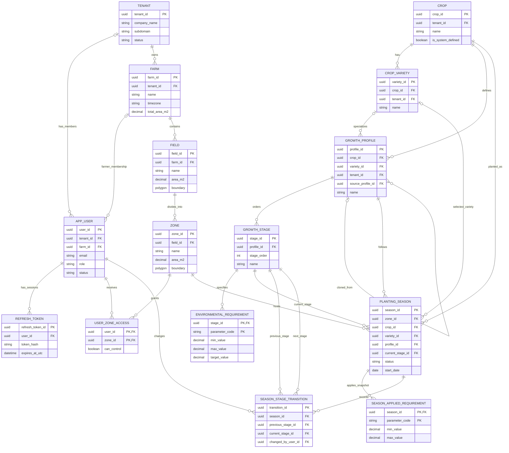
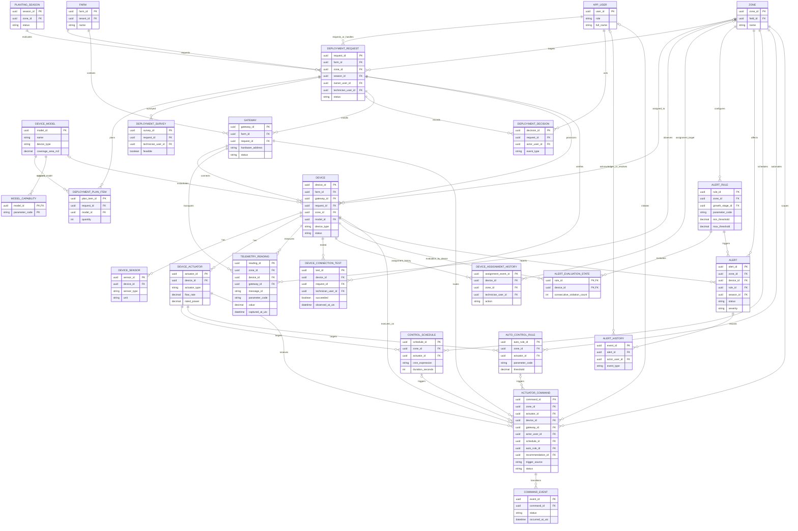
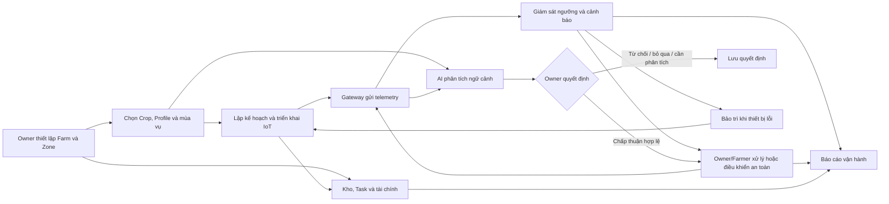

# Đặc tả yêu cầu phần mềm (SRS) — SmartFarm v1

- **Tên hệ thống:** SmartFarm — Nền tảng quản lý nông nghiệp thông minh tích hợp AI
- **Phiên bản tài liệu:** 1.0 (bản tổng hợp từ tài liệu dự án hiện có)
- **Ngày lập:** 12/10/2026
- **Trạng thái:** Bản đặc tả tổng hợp; cần đối chiếu/xác nhận các điểm còn mở ở mục 12 trước khi dùng làm baseline nghiệm thu.
- **Ngôn ngữ:** Tiếng Việt

## Phần I — Tóm tắt theo mẫu Capstone Project Register

Phần này bám theo cấu trúc mẫu đăng ký capstone hiện có trong `frontend/tailieu/FA26SE108_extracted.txt`. Dự án chưa có mẫu SRS riêng; phần II trở đi là đặc tả yêu cầu chi tiết của hệ thống.

### 1.1 Tên đề tài

- **English:** SmartFarm: AI-powered Smart Agriculture Management Platform
- **Tiếng Việt:** SmartFarm: Nền tảng Quản lý Nông nghiệp Thông minh tích hợp AI
- **Lĩnh vực:** Software Engineering
- **Thời gian:** Mẫu đăng ký ghi 09/2026–03/2027; bản tóm tắt đề tài ghi 09/2026–12/2026. Thời gian chính thức cần xác nhận.

### 1.2 Nội dung đề xuất chính

#### a. Bối cảnh

Nông nghiệp đang ứng dụng công nghệ số nhằm nâng năng suất, tối ưu tài nguyên và hỗ trợ canh tác bền vững. IoT/LoRa cho phép giám sát môi trường ở các khu vực canh tác phân tán với kết nối tầm xa và tiêu thụ năng lượng thấp. Các giải pháp hiện hữu thường tập trung thu thập/hiển thị cảm biến, trong khi quản lý Farm, thiết bị, tác nghiệp di động và hỗ trợ quyết định còn rời rạc. SmartFarm hướng tới một nền tảng thống nhất kết hợp quản lý canh tác, IoT, giám sát và tư vấn AI.

#### b. Giải pháp đề xuất

SmartFarm cung cấp Web Management Portal và ứng dụng di động đa nền tảng kết nối backend ASP.NET Core với cơ sở dữ liệu PostgreSQL. Sensor node LoRa gửi dữ liệu qua Gateway/MQTT; hệ thống liên kết readings với Farm/Field/Zone và giai đoạn sinh trưởng để tạo cảnh báo phù hợp. Farm Owner quản lý canh tác, lịch/luật tưới, nhân công, vật tư và tài chính; Farmer thao tác trong Zone/Task được cấp quyền; Platform Technician triển khai và bảo trì IoT. AI tạo tư vấn từ context do server xây dựng và chỉ tạo lệnh điều khiển sau khi Owner chấp thuận recommendation còn hiệu lực. Các ranh giới an toàn và trạng thái thực tế được định nghĩa tại các hợp đồng v1.

#### c. Yêu cầu chức năng cấp cao

- Tài khoản, xác thực, RBAC và cách ly Tenant.
- Quản lý Farm, Field, Zone, Crop/Variety, Growth Profile/Stage và Planting Season.
- Lập kế hoạch, provision, gán, chẩn đoán và theo dõi Gateway/Device.
- Thu nhận telemetry, dashboard/thống kê lịch sử, cấu hình ngưỡng và quản lý Alert.
- Điều khiển actuator thủ công, theo Schedule/AutoRule; ghi nhận feedback, trạng thái và audit.
- Tư vấn AI theo ngữ cảnh mùa vụ/cảm biến/thời tiết và lưu quyết định Owner.
- Quản lý vật tư, nhập/xuất kho, cảnh báo tồn thấp, Task và phân công Farmer.
- Ghi nhận thu/chi, báo cáo dòng tiền, service request, bảo trì/thay thế và báo cáo Farm.

Chi tiết FR-AUTH đến FR-REP tại Phần II, mục 5.

#### d. Yêu cầu phi chức năng cấp cao

- Responsive Web và cross-platform mobile theo định hướng đề tài.
- RESTful JSON API, JWT, phân quyền server-side và cô lập dữ liệu theo Tenant/Zone.
- Kiến trúc backend phân lớp; PostgreSQL; lưu dữ liệu hình học Farm với PostGIS.
- LoRa/MQTT cho IoT; xác thực Gateway và xử lý tin/lệnh idempotent.
- Tư vấn AI qua provider adapter; lưu audit cho điều khiển và nghiệp vụ quan trọng.
- Có health endpoint, correlation ID, timestamp UTC và lịch hiển thị theo timezone Farm.
- Các chỉ tiêu availability, performance, capacity, backup/restore và retention cần được chốt; không có số liệu cam kết trong template hiện có.

Chi tiết NFR-SEC đến NFR-OPS tại Phần II, mục 7.

#### e. Lý thuyết và thực hành áp dụng

- Software Engineering; phân tích yêu cầu và mô hình hóa nghiệp vụ.
- Object-Oriented Analysis and Design; Clean Architecture.
- Database Design, ERD, PostgreSQL và EF Core Code First.
- RESTful API, xác thực và bảo mật ứng dụng đa tenant.
- Internet of Things, LoRa, MQTT và xử lý dữ liệu telemetry.
- Mobile Computing, Human-Computer Interaction và GIS.
- Information Retrieval/LLM integration và giới hạn an toàn của AI hỗ trợ quyết định.
- Software Testing, kiểm thử tích hợp và kiểm thử phân quyền.

#### f. Sản phẩm bàn giao dự kiến

- SmartFarm Web Management Portal.
- SmartFarm Mobile Application.
- Backend REST API và mô hình dữ liệu/migrations.
- Các module Farm, IoT, Monitoring/Alert, Smart Irrigation, AI Assistant, Dashboard/Reporting.
- Tài liệu kiến trúc, SRS, mô hình dữ liệu, API và hướng dẫn sử dụng/vận hành.
- Gói triển khai Docker là sản phẩm dự kiến trong mẫu đăng ký; tình trạng hỗ trợ/đóng gói cần xác minh trước nghiệm thu.

#### g. Nhóm công việc đề xuất

1. **Work Package 1 — Requirements Analysis & System Design:** elicitation, stakeholder/business-flow modeling, kiến trúc, database/ERD, UI/UX và API specification.
2. **Work Package 2 — IoT Platform & Farm Management:** tích hợp LoRa/thiết bị, cấu trúc Farm, môi trường, cảnh báo và quản lý thiết bị.
3. **Work Package 3 — Mobile Application & AI Integration:** ứng dụng Flutter, AI assistant, tư vấn nông nghiệp và tích hợp thời tiết theo hợp đồng được chốt.
4. **Work Package 4 — Dashboard & Analytics:** dashboard, phân tích môi trường, thống kê tài nguyên và báo cáo.
5. **Work Package 5 — Testing & Deployment:** tích hợp, kiểm thử chức năng/hiệu năng, triển khai và tài liệu người dùng.

### 1.3 Ghi chú theo mẫu

Thông tin sinh viên trong bản mẫu đăng ký để trống; SRS này không tự điền danh tính. Phạm vi tích hợp, deliverable và lịch trình là đề xuất ở mẫu capstone, còn mức hiện thực hóa cần đối chiếu `ENDPOINT_STATUS.md` và trạng thái repository.

---
## 1. Mục đích và đối tượng

Tài liệu mô tả yêu cầu chức năng và phi chức năng của SmartFarm dựa trên `SmartFarm_Detailed_Project_Summary(1).md`, tám luồng trong `reference/SmartFarm_Flow.docx`, danh mục API, các hợp đồng v1, ma trận vai trò và trạng thái triển khai hiện có. SRS này gom các yêu cầu ở mức hệ thống; hợp đồng API chuyên biệt là nguồn chi tiết hơn về payload, quy tắc xác thực và vòng đời nghiệp vụ.

Đối tượng sử dụng gồm nhóm capstone, chủ sản phẩm, người phân tích, lập trình viên, kiểm thử viên và người đánh giá nghiệm thu.

### 1.1 Quy ước

- **Shall / Phải:** yêu cầu bắt buộc thuộc phạm vi đã xác lập.
- **Should / Nên:** yêu cầu mong muốn nhưng cần xác nhận ưu tiên.
- **TBD:** tài liệu hiện có chưa quyết định; không tự đặt giá trị.
- Mọi thời điểm lưu trong backend dùng UTC; hiển thị và lập lịch theo múi giờ của Farm.
- API nguồn có 103 mục đánh số; các route bổ sung v1 có mã hợp đồng riêng và không làm đổi số thứ tự nguồn.

## 2. Tổng quan hệ thống

SmartFarm là nền tảng SaaS đa tenant giúp quản lý nhiều Farm, cấu trúc Field/Zone, mùa vụ và điều kiện sinh trưởng; thu thập telemetry từ thiết bị LoRa qua Gateway/MQTT; giám sát, cảnh báo, điều khiển thiết bị; hỗ trợ quyết định bằng AI; quản lý vật tư, công việc, tài chính, bảo trì và báo cáo. Hệ thống gồm cổng web quản lý, ứng dụng di động đa nền tảng theo định hướng đề tài, API backend và các tích hợp IoT/dịch vụ ngoài.

### 2.1 Mục tiêu

1. Tập trung quản lý tổ chức trang trại, mùa vụ và hoạt động vận hành.
2. Liên kết dữ liệu IoT với Crop, Growth Profile và Growth Stage đang áp dụng.
3. Cảnh báo sớm khi điều kiện môi trường lệch khỏi yêu cầu hiện hành.
4. Cho phép điều khiển an toàn, có xác nhận thiết bị và lịch sử kiểm toán.
5. Đưa ra tư vấn AI có nêu giới hạn dữ liệu; AI không trực tiếp điều khiển thiết bị.
6. Cung cấp luồng công việc cho vật tư, nhân công, tài chính và bảo trì.

### 2.2 Phạm vi nghiệp vụ

| Mã | Luồng | Phạm vi chính |
|---|---|---|
| CF1 | Quản lý Farm, canh tác & triển khai IoT | Tenant/Farm/Field/Zone, cây trồng, hồ sơ sinh trưởng, mùa vụ, lập kế hoạch/khảo sát/lắp thiết bị |
| CF2 | Giám sát môi trường & cảnh báo | Nhận, kiểm tra, lưu/tra cứu telemetry; đối chiếu ngưỡng; cảnh báo và xử lý |
| CF3 | Điều khiển môi trường thông minh | Lệnh thủ công, lịch, luật tự động; kiểm tra an toàn; nhận phản hồi thiết bị |
| CF4 | Tư vấn AI & hỗ trợ quyết định | Tạo tư vấn từ ngữ cảnh, lưu quyết định Owner, chuyển khuyến nghị hợp lệ sang luồng điều khiển |
| SUP5 | Vật tư & tồn kho | Danh mục vật tư, nhập/xuất, liên kết nhu cầu, cảnh báo tồn thấp |
| SUP6 | Nhân viên & công việc | Mời Farmer, cấp Zone access, phân công/thi hành/duyệt Task |
| SUP7 | Dòng tiền | Ghi thu/chi, phân loại, báo cáo dòng tiền |
| SUP8 | Bảo trì & thay thế thiết bị | Service Request, phân công kỹ thuật viên, chẩn đoán, sửa chữa/thay thế, kiểm tra và đóng yêu cầu |

### 2.3 Ngoài phạm vi hoặc chưa được xác lập

- Hỗ trợ đa ngôn ngữ ngoài giao diện tiếng Việt/tiếng Anh hiện được nêu ở định vị sản phẩm: chi tiết TBD.
- Thanh toán trực tuyến, kế toán chuẩn pháp quy, thương mại điện tử, dự báo năng suất và tự động đặt mua vật tư không có đặc tả.
- AI tự gửi lệnh đến thiết bị, tự sửa quy tắc, hoặc tự phê duyệt hành động: không thuộc phạm vi và bị cấm theo hợp đồng AI.
- Cam kết SLA, quy mô tải tối đa, RPO/RTO, thời gian phản hồi API và thời gian lưu trữ lâu dài: TBD.
- Knowledge Base AI endpoints #89–#90 và tích hợp thời tiết #103 chưa đủ hợp đồng để coi là yêu cầu triển khai hoàn chỉnh.

## 3. Người dùng và quyền hạn

| Vai trò chuẩn | Mô tả và quyền chính |
|---|---|
| **PlatformAdmin** | Quản trị nền tảng, tài khoản kỹ thuật viên, danh mục hệ thống và audit. Không phải thành viên Tenant/Farm. Một số quyền quản lý tenant/crop/device được đề xuất trong ma trận; phạm vi đọc dữ liệu tenant cần chính sách riêng. |
| **PlatformTechnician** | Tiếp nhận yêu cầu triển khai/bảo trì được phân công; khảo sát, cấu hình, provision/diagnose, gán hoặc thay thiết bị, ghi kết quả kết nối. Không có tenantId/farmId trong danh tính. |
| **FarmOwner** | Chủ tenant; quản lý các Farm, cấu trúc, mùa vụ, người làm, thiết bị nghiệp vụ, quy tắc, điều khiển, AI, kho, Task, tài chính, hỗ trợ và báo cáo. |
| **Farmer** | Người làm thuộc đúng một Farm; chỉ xem Zone được cấp quyền, telemetry/cảnh báo/công việc trong phạm vi; có thể điều khiển khi được cấp cờ `canControl`. |
| **Thiết bị/Gateway** | Tác nhân hệ thống được xác thực ở tầng MQTT, gửi telemetry/phản hồi; không phải tài khoản người dùng. |
| **Dịch vụ ngoài** | Broker MQTT, nhà cung cấp tư vấn AI và nguồn dự báo thời tiết; giao tiếp qua adapter phía server. |

### 3.1 Nguyên tắc truy cập

- Vai trò chuẩn chỉ gồm bốn vai trò nêu trên; nhãn `Manager`/`Employee` trong Flow được ánh xạ lần lượt thành `FarmOwner`/`Farmer`.
- Tenant được lấy từ ngữ cảnh xác thực phía server, không nhận Tenant ID làm căn cứ phân quyền từ client.
- Mọi truy vấn tài nguyên lồng nhau phải xác minh chuỗi cha đầy đủ (Tenant → Farm → Field → Zone → đối tượng con). ID ngoài phạm vi trả về như không tìm thấy để tránh lộ dữ liệu.
- Farmer gắn với đúng một Farm, được cấp quyền cho một hoặc nhiều Zone trong Farm đó. Owner thay thế toàn bộ danh sách Zone access qua thao tác có kiểm tra.
- Platform staff không được gán Tenant/Farm trong JWT; kỹ thuật viên chỉ thay đổi deployment/service request sau khi nhận hoặc được phân công hợp lệ.

## 4. Môi trường và ràng buộc hệ thống

### 4.1 Nền tảng đã ghi nhận

- Backend: .NET 8, ASP.NET Core, Clean Architecture, EF Core Code First.
- Dữ liệu nghiệp vụ: PostgreSQL; PostGIS được bật trong migration hiện tại cho polygon Field/Zone.
- Web: React + TypeScript + Vite theo cấu hình frontend.
- Thiết bị: LoRa node/gateway; telemetry/uplink và lệnh/feedback qua MQTT adapter có xác thực.
- AI: `IAiAdvisoryProvider`; Gemini là adapter có thể cấu hình. Từ chối/giới hạn rõ ràng khi provider/context không khả dụng.
- Thời tiết: `IRainForecastProvider`/nguồn dự báo độc lập với AI; nhà cung cấp, cache và SLA cần xác nhận.
- TimescaleDB, pgvector và Redis được đề xuất trong stack nhưng chưa được bật/không được mặc định coi là phụ thuộc khả dụng.

### 4.2 Ràng buộc triển khai

- Migration do EF Core Code First quản lý; không reverse engineer database thành nguồn entity.
- Bí mật, khóa ký JWT, thông tin kết nối và API key chỉ nạp qua cấu hình môi trường/secret store; không commit vào mã nguồn.
- API v1 theo nhóm `/api/v1`; lỗi chuẩn RFC 7807-compatible; response có `X-Correlation-ID` theo README.
- Tài liệu hợp đồng Auth, Farm Structure, Crop Growth, IoT Deployment, Telemetry/Alert, Control, AI, Inventory/Task, Finance/Service và Reporting giải quyết các khác biệt so với tài liệu nguồn.

## 5. Yêu cầu chức năng

Các yêu cầu dưới đây được đánh mã để tiện truy vết. Mã endpoint hoặc tài liệu hợp đồng tương ứng ghi trong ngoặc khi có.

### 5.1 Tài khoản, xác thực và Tenant

- **FR-AUTH-01:** Hệ thống phải cho phép đăng ký tài khoản FarmOwner hoặc Farmer chưa gắn Tenant; không cho tự đăng ký PlatformAdmin/PlatformTechnician. (AUTH-V1-01)
- **FR-AUTH-02:** Hệ thống phải xác thực người dùng bằng email/mật khẩu, phát hành access token và refresh token luân chuyển; lỗi đăng nhập không tiết lộ email có tồn tại hay không. (API #1–#3)
- **FR-AUTH-03:** Hệ thống phải khóa tài khoản 15 phút sau 5 lần đăng nhập sai liên tiếp; access token sống 60 phút, refresh token 30 ngày theo hợp đồng hiện hành.
- **FR-AUTH-04:** Owner đã đăng nhập phải tạo Tenant trong bước thiết lập đầu tiên; Tenant lấy theo danh tính Owner hiện tại. Farmer được mời phải là tài khoản Farmer có sẵn, đang hoạt động và chưa thuộc Farm nào. (API #10/#13)
- **FR-AUTH-05:** Owner phải quản lý thông tin user trong Tenant; cấp/thay thế tập Zone access cho Farmer, với cờ cho phép điều khiển từng Zone. (API #6/#7, USER-V1-01)
- **FR-AUTH-06:** Hệ thống phải thu hồi refresh token/session khi logout; lưu hash refresh token thay vì token thô. Không trả secret hoặc mật khẩu qua API.
- **FR-AUTH-07:** Khôi phục mật khẩu, đổi mật khẩu và vòng đời gửi OTP/email chưa triển khai đầy đủ; khi hoàn thiện phải xác lập nhà cung cấp và chính sách token trước khi bật. (API #4/#5/#12 deferred)

### 5.2 Quản lý Farm, Field, Zone và mùa vụ

- **FR-FARM-01:** Owner phải tạo, đọc, cập nhật, lưu trữ (archive) Farm trong Tenant của mình. (API #16–#22)
- **FR-FARM-02:** Owner phải tạo Field thuộc Farm và Zone thuộc Field; lưu ranh giới Polygon dạng GeoJSON ở API và PostGIS trong cơ sở dữ liệu. (API #23–#32)
- **FR-FARM-03:** Hệ thống phải bảo toàn lịch sử vận hành bằng archive thay vì xóa cứng các đối tượng có dữ liệu liên quan.
- **FR-CROP-01:** Hệ thống phải cung cấp danh mục Crop/Variety và Growth Profile/Stage; hỗ trợ Owner tạo hồ sơ tenant bằng cách clone profile hệ thống trước khi chỉnh sửa. Profile hệ thống không được sửa trực tiếp. (API #33–#40)
- **FR-CROP-02:** Owner phải mở Planting Season cho Zone, chuyển Growth Stage và đóng mùa vụ. Mỗi Zone có tối đa một mùa vụ InProgress. (API #41–#45)
- **FR-CROP-03:** Khi chuyển Stage, hệ thống phải thay thế snapshot yêu cầu môi trường được áp dụng cho mùa vụ trong cùng giao dịch để việc giám sát dùng đúng ngưỡng hiện hành.
- **FR-FARM-04:** Bước submit/approval Farm (#22) đang deferred; không giả định rằng Farm draft có workflow phê duyệt cho tới khi hợp đồng được hoàn thiện.

### 5.3 Lập kế hoạch triển khai và quản lý IoT

- **FR-IOT-01:** Hệ thống phải suy ra các chỉ số cần đo từ yêu cầu môi trường của Growth Stage hiện tại; đưa ra model tương thích và số lượng theo diện tích/độ phủ thiết bị. (IOT-V1-01/02)
- **FR-IOT-02:** Owner phải tạo/chỉnh sửa kế hoạch thiết bị và gửi Deployment Request. Một Zone chỉ có tối đa một yêu cầu đang xử lý theo các trạng thái quy định. (IOT-V1-03/06)
- **FR-IOT-03:** Technician phải nhận yêu cầu, khảo sát điều kiện thực tế, ghi tính khả thi, điều chỉnh và xác nhận phương án trước lắp đặt. (IOT-V1-07/11)
- **FR-IOT-04:** Technician phải bắt đầu lắp đặt, provision thiết bị/gateway, gán thiết bị vào Zone theo kế hoạch đã xác nhận và ghi nhận kết quả connection test quan sát được. (IOT-V1-12/14; API #54–#68)
- **FR-IOT-05:** Hoàn tất triển khai chỉ khi mọi thiết bị kế hoạch đã gán đúng và lần kiểm tra gần nhất thành công. Triển khai thất bại phải lưu lý do và tạo Service Request handoff. (IOT-V1-14/15)
- **FR-IOT-06:** Firmware/diagnostic là công việc bất đồng bộ; hệ thống không được báo đã chạy thành công chỉ vì đã nhận HTTP request. Chỉ phản hồi thiết bị có xác thực mới xác nhận hoàn thành.
- **FR-IOT-07:** Bí mật Gateway không được trả trong API đọc. Thiết bị không được gán chéo Farm, gán trùng hoặc gán vào Zone ngoài yêu cầu hợp lệ.

### 5.4 Telemetry và cảnh báo

- **FR-TEL-01:** Gateway đã xác thực phải gửi telemetry qua adapter MQTT; danh tính Gateway lấy từ transport identity/topic được kiểm tra, không lấy từ payload tùy ý. (Telemetry contract)
- **FR-TEL-02:** Hệ thống phải xác thực payload, timestamp UTC, tham số/đơn vị, Device–Gateway–Zone relationship và tính duy nhất. Tin trùng phải xử lý idempotent, không lưu lặp và không tăng bộ đếm cảnh báo.
- **FR-TEL-03:** Hệ thống phải lưu dữ liệu hợp lệ và cung cấp giá trị mới nhất, lịch sử và thống kê theo Zone, trong giới hạn truy vấn 90 ngày và các bước tổng hợp được hợp đồng hỗ trợ.
- **FR-TEL-04:** Hệ thống phải đánh dấu telemetry tươi theo cửa sổ 5 phút; dữ liệu cũ vẫn tra cứu được nhưng không chứng minh thiết bị đang online.
- **FR-ALERT-01:** Hệ thống phải so sánh readings với snapshot yêu cầu của Stage hiện tại; chỉ phát cảnh báo sau hai lần vi phạm liên tiếp, reset bộ đếm khi trở lại ngưỡng và áp dụng chặn lặp/cooldown.
- **FR-ALERT-02:** Owner phải cấu hình alert rules. Owner và Farmer có quyền Zone phù hợp được xem cảnh báo; Farmer chỉ acknowledgement/resolution trong Zone được cấp.
- **FR-ALERT-03:** Acknowledge và Resolve là hai thao tác riêng. Mọi sự kiện tạo, xác nhận và xử lý phải có actor/thời điểm UTC và lịch sử append-only.
- **FR-ALERT-04:** Kênh thông báo push/email/SMS, trạng thái đã đọc và cam kết giao nhận chưa được đặc tả; chức năng thông báo cần xác nhận provider/policy trước nghiệm thu.

### 5.5 Điều khiển, lịch và tự động hóa

- **FR-CTRL-01:** Owner phải phát lệnh thủ công tới actuator trong Zone hợp lệ; Farmer chỉ được phát lệnh khi có Zone access và `canControl=true`. Lệnh thủ công phải có idempotency key. (API #80–#83)
- **FR-CTRL-02:** Hệ thống phải hỗ trợ lệnh Manual, Schedule, AutoRule và AI_APPROVED; lưu actor, nguồn, trạng thái và lịch sử bất biến.
- **FR-CTRL-03:** Lệnh phải chạy bất đồng bộ theo `Pending → Sent → Acknowledged/Failed/TimedOut/Cancelled`. Chỉ feedback thiết bị đã xác thực mới xác nhận hành động thực tế; HTTP 202 hoặc MQTT publish không có nghĩa là thiết bị đã chạy.
- **FR-CTRL-04:** Tưới phải có thời lượng 1–1800 giây và không vượt giới hạn actuator. Server phải kiểm tra interlock (tối đa một bơm nước đang hoạt động mỗi Zone), thời tiết/mưa nếu bật rain delay, freshness và xung đột lệnh trước khi gửi.
- **FR-CTRL-05:** Manual có ưu tiên cao hơn lịch/luật. Nếu cần dừng lệnh đang chạy, hệ thống phải đợi feedback hủy khẩn cấp đã xác thực trước khi dispatch manual command.
- **FR-CTRL-06:** Owner phải cấu hình Schedule và AutoRule. Cron v1 dùng 5 trường; diễn giải theo múi giờ Farm. Rule v1 hỗ trợ so sánh ngưỡng, thời gian duy trì điều kiện và cooldown; không tuyên bố rule đã đồng bộ Gateway khi chưa có ACK.
- **FR-CTRL-07:** Trạng thái hiện tại chỉ phản ánh feedback đã ACK và cutoff; lệnh Sent chưa được trình bày như trạng thái thiết bị đã chạy.

### 5.6 Tư vấn AI

- **FR-AI-01:** Owner phải hỏi AI theo Zone; ngữ cảnh phải do server dựng từ Farm/Zone/mùa vụ/Stage/ngưỡng/telemetry freshness/weather/actuator, không tin context do client gửi. (API #84/#85)
- **FR-AI-02:** Hệ thống phải lưu consultation/recommendation, mức tin cậy, dữ liệu thiếu/hạn chế và quyết định Owner; có giới hạn tần suất cấu hình và thời hạn hiệu lực recommendation.
- **FR-AI-03:** Thiếu mùa vụ/Stage/telemetry tươi/thời tiết, provider lỗi hoặc confidence thấp thì kết quả phải được đánh dấu giới hạn và không actionable; không bịa dữ liệu/hướng dẫn.
- **FR-AI-04:** Owner có thể Accept/Reject/Ignore/MoreAnalysis. Chỉ recommendation còn hiệu lực, actionable và đủ confidence mới được Accept. Accept tạo lệnh qua Control; các quyết định khác không tạo lệnh.
- **FR-AI-05:** AI không được gửi lệnh trực tiếp, thay AutoRule/Schedule hay tự thay đổi trạng thái hệ thống. Lệnh bắt nguồn AI phải lưu recommendation ID và source `AI_APPROVED`.
- **FR-AI-06:** Ẩn lịch sử AI không xóa consultation, decision hoặc command audit. Knowledge Base endpoints #89–#90 deferred tới khi có hợp đồng dữ liệu/provenance/access.

### 5.7 Vật tư, công việc và tài chính

- **FR-OPS-01:** Owner phải quản lý danh mục vật tư Farm; tên phải duy nhất không phân biệt hoa/thường trong Farm. Nhập kho ghi thành receipt riêng và có audit movement. (API #96/#97; INVENTORY-V1)
- **FR-OPS-02:** Owner/Farmer được phép xuất vật tư cho Zone và tùy chọn Task theo phân quyền; số lượng dương, tồn kho không âm; thay đổi tồn kho và movement phải nguyên tử.
- **FR-OPS-03:** Owner phải cấu hình nhu cầu vật tư liên kết đúng một đối tượng Crop, Variety hoặc Growth Stage; hệ thống mở cảnh báo tồn thấp khi chạm/vượt ngưỡng theo chiều giảm, và đóng khi nhập đủ.
- **FR-TASK-01:** Owner tạo Task cho Zone, nội dung, hạn và Farmer được giao; Farmer chỉ xem Task của mình. Assignee phải thuộc Farm và được phép với Zone.
- **FR-TASK-02:** Farmer được Accept/Start/Complete/Fail Task; Owner được Approve/Reassign theo chuyển trạng thái quy định. Task quá hạn được đánh dấu Overdue; Failed/Overdue được phân công lại; mọi trạng thái/assignment có audit.
- **FR-FIN-01:** Owner phải ghi Revenue và Expense có số tiền dương, ngày, mô tả/tham chiếu; Expense phân nhóm Material, Farmer, IoT, Maintenance hoặc Other. Thu không đổi thành chi hoặc ngược lại khi cập nhật.
- **FR-FIN-02:** Owner phải truy vấn dòng tiền theo khoảng thời gian UTC: net cash flow = tổng doanh thu − tổng chi phí; bản ghi archive không tính vào report.

### 5.8 Bảo trì, dịch vụ và báo cáo

- **FR-SVC-01:** Owner phải mở Service Request cho thiết bị trong Farm/Zone hợp lệ. Request có thể phát sinh từ lỗi deployment. (SERVICE-V1)
- **FR-SVC-02:** Admin phân công Technician; Technician được giao tiếp nhận, chẩn đoán và chọn Maintenance/Repair/Replacement; mọi lần phân công/chẩn đoán/công việc được audit.
- **FR-SVC-03:** Replacement chỉ sau khi diagnosis chọn Replacement; thiết bị thay thế phải tương thích, chưa gán và cùng Farm. Phải lưu liên kết old–new, giữ lịch sử assignment và decommission thiết bị cũ.
- **FR-SVC-04:** Chỉ đóng request khi connection test mới nhất của thiết bị hiện hành thành công. HTTP thành công không phải kết quả kiểm tra phần cứng.
- **FR-REP-01:** Owner phải xem tổng quan Farm, tổng kết mùa vụ, dùng nước/điện, kho, task, maintenance và cash flow trong phạm vi quyền hạn.
- **FR-REP-02:** Chỉ lệnh tưới đã Acknowledged mới được tính vào lượng nước; chỉ lệnh actuator đã Acknowledged mới đóng góp mức điện. Thiếu flow/power rating phải được tính là chưa đo được, không suy đoán.

## 6. Yêu cầu giao diện ngoài

### 6.1 Giao diện người dùng

- Web portal và ứng dụng mobile theo phạm vi đề tài dùng dashboard theo vai trò; chi tiết tương tác/khả năng truy cập, hỗ trợ thiết bị và offline mode TBD.
- Giao diện cần phản ánh rõ trạng thái lệnh bất đồng bộ, freshness dữ liệu, cảnh báo chưa xử lý và giới hạn AI; không nhầm trạng thái yêu cầu với kết quả vật lý.
- Bản đồ Farm hỗ trợ xem/chỉnh polygon Field/Zone. Chi tiết bản đồ nền, định dạng export, GPS và yêu cầu offline TBD.

### 6.2 API và tích hợp thiết bị

- REST API JSON phiên bản `/api/v1`, Bearer token; lỗi validation/authorization/concurrency theo RFC 7807-compatible Problem Details.
- MQTT uplink/downlink/feedback qua adapter; topic và payload chuẩn nằm trong `TELEMETRY_ALERT_CONTRACT_V1.md` và `CONTROL_CONTRACT_V1.md`.
- Adapter dịch vụ AI nhận context có cấu trúc; adapter dự báo mưa độc lập với AI. Provider mặc định không khả dụng phải trả giới hạn rõ ràng.
- Email/push/SMS notification: provider, cấu hình, retry và hợp đồng giao nhận TBD.

### 6.3 Dữ liệu

- PostgreSQL là nguồn dữ liệu nghiệp vụ chính, EF Core migrations là nguồn triển khai schema.
- Dữ liệu audit của lệnh actuator, xác nhận/xử lý Alert, quyết định AI, movement tồn kho, chuyển trạng thái Task, deployment và service lifecycle phải được bảo toàn theo hợp đồng.
- Polygon lưu PostGIS Geometry Polygon SRID 4326 theo README/migration hiện hành. TimescaleDB/pgvector chưa là yêu cầu bắt buộc của v1.

## 7. Yêu cầu phi chức năng

### 7.1 Bảo mật và riêng tư

- **NFR-SEC-01:** Mọi endpoint nghiệp vụ phải xác thực/ủy quyền phía server; UI guard không thay thế backend authorization.
- **NFR-SEC-02:** Cách ly dữ liệu theo Tenant và toàn chuỗi resource parent; không cho phép client tự chọn Tenant khi ghi/đọc.
- **NFR-SEC-03:** Mật khẩu phải đáp ứng chính sách độ mạnh của Auth contract; refresh token chỉ lưu SHA-256 hash; JWT signing key và provider secret phải ở secret configuration.
- **NFR-SEC-04:** MQTT Gateway/feedback phải xác thực client ID và certificate fingerprint; payload không được tự xác định Tenant/Gateway.
- **NFR-SEC-05:** Audit không được sửa ngược/xóa khi người dùng ẩn bản ghi lịch sử trên giao diện.
- **NFR-SEC-06:** Dữ liệu cá nhân, chính sách lưu/xóa, mã hóa at-rest/in-transit ngoài TLS mặc định môi trường và phân quyền PlatformAdmin với dữ liệu tenant cần chính sách bảo vệ riêng (TBD).

### 7.2 Tính toàn vẹn và an toàn vận hành

- **NFR-REL-01:** Các thao tác đa bản ghi như Tenant setup, Farmer assignment, thay Zone access, chuyển Stage, xuất kho và thay thiết bị phải giao dịch nguyên tử.
- **NFR-REL-02:** Telemetry ingestion và lệnh có idempotency để chống gửi lặp; trạng thái thiết bị chỉ dựa vào feedback tin cậy.
- **NFR-REL-03:** Mọi lệnh actuator phải áp dụng server-side interlock, cutoff tối đa 30 phút và ghi audit chuyển trạng thái.
- **NFR-REL-04:** Khi context/provider cần thiết bị thiếu hoặc hỏng, hệ thống từ chối/đưa ra kết quả non-actionable an toàn; không tạo dữ liệu thành công giả.
- **NFR-REL-05:** Dữ liệu thao tác quan trọng phải archive thay vì xóa vật lý để giữ báo cáo/lịch sử.

### 7.3 Hiệu năng và dung lượng

- **NFR-PERF-01:** Mốc SLA, throughput, p95 latency, số tenant/zone/device đồng thời, MQTT message rate và dashboard refresh interval chưa có trong nguồn và phải được chốt trước kiểm thử tải.
- **NFR-PERF-02:** Truy vấn telemetry lịch sử phải giới hạn tối đa 90 ngày mỗi yêu cầu; hỗ trợ aggregation 1m, 5m, 15m, 1h, 1d theo contract hiện hành.
- **NFR-PERF-03:** Chỉ số freshness được tính theo ngưỡng 5 phút hiện hành; đây là ngưỡng freshness, không phải SLA cập nhật dashboard.

### 7.4 Khả năng bảo trì, tương thích và vận hành

- **NFR-MNT-01:** Backend giữ ranh giới Clean Architecture; Domain không phụ thuộc framework; migration cần được xem xét trước khi áp dụng môi trường dùng chung.
- **NFR-MNT-02:** API dùng cancellation token, validation, Problem Details và correlation ID theo coding standards.
- **NFR-COMP-01:** Backend hiện ghim .NET 8/EF Core 8; PostgreSQL phiên bản mục tiêu trong README là 16 hoặc tương thích Npgsql 8; trình duyệt/mobile OS hỗ trợ tối thiểu TBD.
- **NFR-OPS-01:** Health endpoint `/health`; telemetry, correlation, cấu hình và secret management cho production phải có chính sách monitoring/backup/retention rõ ràng trước phát hành.

### 7.5 Múi giờ và dữ liệu thời gian

- **NFR-DATA-01:** Timestamp sự kiện lưu UTC; lịch biểu và giao diện diễn giải theo IANA timezone của Farm.
- **NFR-DATA-02:** Dữ liệu tương lai không quá 5 phút và dữ liệu telemetry cũ hơn 7 ngày bị loại khi ingest theo contract; lịch sử được đọc theo UTC.
- **NFR-DATA-03:** Công thức báo cáo dùng các định nghĩa trong `REPORTING_CONTRACT_V1.md`, không suy đoán thành công từ command đã gửi.

## 8. Entity Relationship Diagram — Mô hình dữ liệu khái niệm

Mô hình dưới đây thể hiện các thực thể nghiệp vụ chính và quan hệ của chúng theo tài liệu Report 3, Domain entities, hợp đồng API và quy tắc vận hành. Đây là **conceptual data model**: các thuộc tính chỉ nêu định danh/ý nghĩa chính; chưa biểu diễn đầy đủ kiểu dữ liệu, index, khóa ngoại phụ trợ, enum, bảng audit chung hay chiến lược lưu trữ. Tên và cardinality cần được đối chiếu với Entity Framework mappings/migrations khi lập ERD vật lý.

### 8.1 Tenant, người dùng, Farm và vòng đời cây trồng

**Diễn giải:** Tenant sở hữu Farm; Farm phân cấp tới Field rồi Zone. Tài khoản có thể là thành viên Tenant, còn Farmer được gắn với một Farm và nhận quyền ở từng Zone qua `USER_ZONE_ACCESS`; `can_control` quyết định quyền điều khiển. Crop có thể thuộc thư viện hệ thống hoặc Tenant; Variety/Profile tùy chọn theo Crop. Planting Season gắn Zone với Crop, Profile và Stage hiện hành. Ngưỡng áp dụng được snapshot vào mùa vụ để thay đổi Stage không làm mất lịch sử; chuyển giai đoạn lưu thành các sự kiện riêng.

### 8.2 Triển khai IoT, telemetry, cảnh báo và điều khiển

**Diễn giải:** Deployment Request nối nhu cầu của mùa vụ/Zone với khảo sát, kế hoạch, Gateway và Device đã cài đặt. Gateway quản lý kết nối tới nhiều Device; Device có thể có nhiều Sensor/Actuator, readings gắn Device, Gateway và Zone. Alert được kích hoạt theo rule/stage và giữ history. Schedule/AutoRule có thể tạo Actuator Command; mỗi command lưu nguồn và event state. Quan hệ đến AI Recommendation được thể hiện ở mô hình tư vấn bên dưới.

### 8.3 Tư vấn AI, công việc, kho, tài chính và bảo trì

```mermaid
erDiagram
    TENANT {
        uuid tenant_id PK
        string company_name
    }
    FARM {
        uuid farm_id PK
        uuid tenant_id FK
        string name
    }
    ZONE {
        uuid zone_id PK
        string name
    }
    APP_USER {
        uuid user_id PK
        string role
        string full_name
    }
    DEVICE {
        uuid device_id PK
        string hardware_address
        string status
    }
    PLANTING_SEASON {
        uuid season_id PK
        uuid zone_id FK
        string status
    }
    AI_CONSULTATION {
        uuid consultation_id PK
        uuid zone_id FK
        uuid requested_by_user_id FK
        uuid parent_recommendation_id FK
        string status
    }
    AI_RECOMMENDATION {
        uuid recommendation_id PK
        uuid consultation_id FK
        uuid growth_stage_id FK
        string status
        decimal confidence
        datetime valid_until_utc
    }
    AI_DECISION {
        uuid decision_id PK
        uuid recommendation_id FK
        uuid owner_user_id FK
        uuid actuator_command_id FK
        string decision_type
    }
    ACTUATOR_COMMAND {
        uuid command_id PK
        uuid recommendation_id FK
        string trigger_source
        string status
    }
    FARM_TASK {
        uuid task_id PK
        uuid zone_id FK
        uuid assigned_farmer_id FK
        uuid created_by_owner_id FK
        string status
        datetime due_at_utc
    }
    TASK_HISTORY {
        uuid task_history_id PK
        uuid task_id FK
        uuid actor_user_id FK
        string event_type
    }
    INVENTORY_ITEM {
        uuid item_id PK
        uuid farm_id FK
        string name
        decimal quantity_on_hand
        decimal low_stock_threshold
    }
    MATERIAL_REQUIREMENT_LINK {
        uuid requirement_link_id PK
        uuid item_id FK
        uuid crop_id FK
        uuid variety_id FK
        uuid growth_stage_id FK
    }
    INVENTORY_TRANSACTION {
        uuid inventory_transaction_id PK
        uuid item_id FK
        uuid actor_user_id FK
        uuid zone_id FK
        uuid task_id FK
        decimal quantity
        decimal balance_after
    }
    LOW_STOCK_ALERT {
        uuid low_stock_alert_id PK
        uuid item_id FK
        string status
        decimal quantity_at_open
    }
    FINANCE_TRANSACTION {
        uuid finance_transaction_id PK
        uuid farm_id FK
        uuid created_by_owner_id FK
        string transaction_type
        decimal amount
        datetime occurred_at_utc
    }
    SERVICE_REQUEST {
        uuid service_request_id PK
        uuid farm_id FK
        uuid zone_id FK
        uuid device_id FK
        uuid assigned_technician_id FK
        string status
        string resolution_action
    }
    SERVICE_HISTORY {
        uuid service_history_id PK
        uuid service_request_id FK
        uuid actor_user_id FK
        string event_type
    }
    DEVICE_REPLACEMENT {
        uuid replacement_id PK
        uuid service_request_id FK
        uuid old_device_id FK
        uuid new_device_id FK
        uuid technician_user_id FK
    }
    SERVICE_QUOTATION {
        uuid quotation_id PK
        uuid service_request_id FK
        uuid technician_user_id FK
        decimal total_amount
        string status
    }
    QUOTATION_ITEM {
        uuid quotation_item_id PK
        uuid quotation_id FK
        string hardware_item_code
        int quantity
        decimal total_amount
    }
    SERVICE_PAYMENT {
        uuid payment_id PK
        uuid service_request_id FK
        uuid quotation_id FK
        decimal amount
        string status
    }
    AUDIT_LOG {
        uuid audit_log_id PK
        uuid actor_user_id FK
        string action
        string entity_name
        datetime created_at_utc
    }

    TENANT ||--o{ FARM : owns
    FARM ||--o{ FINANCE_TRANSACTION : records
    APP_USER ||--o{ FINANCE_TRANSACTION : creates
    ZONE ||--o{ FARM_TASK : scopes
    APP_USER ||--o{ FARM_TASK : assigned_farmer
    APP_USER ||--o{ FARM_TASK : creates
    APP_USER ||--o{ TASK_HISTORY : performs
    FARM_TASK ||--o{ TASK_HISTORY : tracks
    FARM ||--o{ INVENTORY_ITEM : stocks
    INVENTORY_ITEM ||--o{ MATERIAL_REQUIREMENT_LINK : needed_for
    INVENTORY_ITEM ||--o{ INVENTORY_TRANSACTION : moves
    APP_USER ||--o{ INVENTORY_TRANSACTION : records
    ZONE o|--o{ INVENTORY_TRANSACTION : used_in
    FARM_TASK o|--o{ INVENTORY_TRANSACTION : used_for
    INVENTORY_ITEM ||--o{ LOW_STOCK_ALERT : raises
    ZONE ||--o{ AI_CONSULTATION : context_for
    APP_USER ||--o{ AI_CONSULTATION : asks
    AI_CONSULTATION ||--o| AI_RECOMMENDATION : returns
    AI_RECOMMENDATION ||--o{ AI_DECISION : receives
    APP_USER ||--o{ AI_DECISION : owner_decides
    AI_RECOMMENDATION o|--o| ACTUATOR_COMMAND : may_authorize
    SERVICE_REQUEST ||--o{ SERVICE_HISTORY : tracks
    APP_USER ||--o{ SERVICE_HISTORY : acts
    DEPLOYMENT_REQUEST o|--o{ SERVICE_REQUEST : hands_off_to
    FARM ||--o{ SERVICE_REQUEST : requests_service
    ZONE ||--o{ SERVICE_REQUEST : service_location
    DEVICE o|--o{ SERVICE_REQUEST : reported_device
    APP_USER o|--o{ SERVICE_REQUEST : assigned_technician
    SERVICE_REQUEST ||--o{ DEVICE_REPLACEMENT : may_replace
    DEVICE ||--o{ DEVICE_REPLACEMENT : old_device
    DEVICE ||--o{ DEVICE_REPLACEMENT : new_device
    SERVICE_REQUEST ||--o{ SERVICE_QUOTATION : quotes
    SERVICE_QUOTATION ||--o{ QUOTATION_ITEM : itemizes
    SERVICE_REQUEST ||--o{ SERVICE_PAYMENT : collects
    SERVICE_QUOTATION o|--o{ SERVICE_PAYMENT : paid_against
    APP_USER o|--o{ AUDIT_LOG : performs
```

**Diễn giải:** AI Consultation tạo tối đa một Recommendation; Owner quyết định và có thể liên kết quyết định Accept với Actuator Command. Task có một Farmer được giao và nhiều lịch sử trạng thái. Inventory Item có các movement, ngưỡng cảnh báo và liên kết nhu cầu mùa vụ/cây trồng; movement có thể gắn Zone/Task. Finance Transaction ghi thu/chi theo Farm. Service Request giữ lịch sử, báo giá/thanh toán và quan hệ thay thế thiết bị; `DEVICE_REPLACEMENT` phân biệt thiết bị cũ với thiết bị mới.

### 8.4 Ràng buộc khái niệm cần bảo toàn

- Tenant phân lập dữ liệu Farm; quan hệ con phải truy vết được về Tenant qua Farm.
- Farmer thuộc đúng một Farm; quyền Zone là quan hệ nhiều-nhiều có thuộc tính `can_control`.
- Mỗi Zone có tối đa một Planting Season đang `InProgress`.
- Crop/Growth Profile hệ thống được dùng chung nhưng không sửa trực tiếp; profile tenant có thể truy nguồn bản clone.
- Telemetry được chống trùng theo định danh thiết bị/message/thời điểm/tham số; Alert, Task, Command, Service và Inventory đều cần lưu lịch sử nghiệp vụ.
- Command có tối đa một nguồn quy tắc/lịch/recommendation phù hợp với `TriggerSource`; trạng thái physical chỉ được xác nhận bởi feedback thiết bị.
- Service Request đóng khi kiểm tra thiết bị hiện hành thành công; thay thế giữ liên kết Device cũ–mới.
- Các FK/unique constraints thực tế cần xác nhận trong Fluent API và migration; diagram không tự khẳng định rằng mọi quan hệ logic đã có FK vật lý.

## 9. Quy tắc nghiệp vụ quan trọng

1. Farm hierarchy là `Tenant → Farm → Field → Zone`.
2. Farmer chỉ thuộc một Farm; quyền Zone của Farmer nằm trong Farm đó.
3. Một Zone có tối đa một Planting Season `InProgress`.
4. Profile hệ thống là immutable; tùy chỉnh theo tenant bằng clone.
5. Stage transition làm mới applied requirements nguyên tử.
6. Telemetry nhận tin cậy qua Gateway đã xác thực; duplicate không làm thay đổi alert evaluator.
7. Alert tạo sau hai lần vi phạm liên tiếp; acknowledgement khác resolution; lưu lịch sử append-only.
8. Command actuator là bất đồng bộ; physical success chỉ sau feedback xác thực; giới hạn tưới 30 phút.
9. AI chỉ tư vấn; chỉ Owner được chấp thuận recommendation hợp lệ để tạo lệnh.
10. Kho không được âm; mọi receipt/issue có movement audit.
11. Farmer chỉ hoàn thành Task đã giao; Owner approve hoặc reassign theo trạng thái cho phép.
12. Service Request chỉ đóng sau test thành công trên thiết bị hiện hành.
13. Archive không xóa lịch sử nghiệp vụ/audit.
14. Timestamp lưu UTC, lịch chạy theo timezone Farm.

## 10. Tiêu chí nghiệm thu mức hệ thống

Hệ thống được xem là đáp ứng SRS khi kiểm chứng được các nhóm sau bằng test/kiểm thử tích hợp phù hợp:

- Tài khoản có đúng vai trò và phạm vi Tenant; truy cập chéo Tenant/Zone bị từ chối.
- Cấu trúc Farm/crop/season duy trì ràng buộc, clone profile không làm thay đổi template hệ thống.
- Telemetry xác thực, chống trùng, freshness chính xác; quy tắc anti-flap tạo và ghi nhận Alert đúng.
- Command không báo thành công trước ACK; interlock/rain-delay/permission/freshness và cutoff được áp dụng.
- AI thiếu context hoặc provider lỗi tạo phản hồi giới hạn không actionable; chỉ Owner mới chấp thuận lệnh.
- Nhập/xuất kho bảo toàn số dư/audit; Task chuyển trạng thái/assignee đúng quyền; báo cáo dùng công thức hợp đồng.
- Triển khai/bảo trì giữ lịch sử và chỉ đóng workflow khi kiểm tra kết nối thực tế hợp lệ.
- API lỗi và validation có định dạng chuẩn, correlation ID và timestamp đúng quy ước.

Ngưỡng hiệu năng, kiểm thử bảo mật theo tiêu chuẩn, backup/restore và kiểm thử khả dụng sẽ chỉ nghiệm thu sau khi các giá trị TBD mục 12 được thống nhất.

## 11. Truy vết tài liệu nguồn và hiện trạng

| Nhóm SRS | Nguồn chuẩn chi tiết |
|---|---|
| Tổng quan, mục tiêu, vai trò | `frontend/tailieu/SmartFarm_Detailed_Project_Summary(1).md`; `frontend/docs/role-permission-matrix.md` |
| Tám business flow | `backend/SmartFarm/docs/reference/SmartFarm_Flow.docx` |
| API và chỉ số endpoint | `backend/SmartFarm/docs/API_CATALOG.md`; `docs/reference/API .docx` |
| Auth, Tenant, quyền | `AUTH_CONTRACT_V1.md`; `DECISIONS.md` |
| Farm/Field/Zone | `FARM_STRUCTURE_CONTRACT_V1.md` |
| Crop/season | `CROP_GROWTH_CONTRACT_V1.md` |
| IoT deployment | `IOT_DEPLOYMENT_CONTRACT_V1.md` |
| Telemetry/alert | `TELEMETRY_ALERT_CONTRACT_V1.md` |
| Điều khiển | `CONTROL_CONTRACT_V1.md` |
| AI | `AI_RECOMMENDATION_CONTRACT_V1.md` |
| Kho/Task | `INVENTORY_TASK_CONTRACT_V1.md` |
| Finance/service | `FINANCE_SERVICE_CONTRACT_V1.md` |
| Báo cáo | `REPORTING_CONTRACT_V1.md` |
| Nền tảng/ERD kỹ thuật | `README.md`, `CODE_FIRST.md`, Domain entities, EF Core migrations |

`ENDPOINT_STATUS.md` ghi nhận tại lần audit 2026-09-25: 94/103 endpoint có triển khai, 6 deferred (#4,#5,#8,#9,#12,#22), 3 chưa đủ contract (#89,#90,#103). Số liệu là ảnh chụp tại ngày audit, không thay cho lần kiểm tra mã mới nhất. Các route bổ sung có trạng thái riêng; không suy ra toàn bộ yêu cầu v1 đã hoàn tất chỉ từ endpoint có route.

## 12. Các điểm cần chốt để baseline cuối

1. **Người dùng và tenant:** phần summary nói “Farm Owner = Tenant”, nhưng Auth contract hiện hành mô hình hóa Owner là user gắn với Tenant và một Owner có thể có nhiều Farm. Tài liệu SRS theo contract v1; xác nhận đây là mô hình chính thức.
2. **Farm onboarding:** submission/approval endpoint #22 còn deferred; quyết định Farm có trạng thái draft/review/approved hay kích hoạt tức thì.
3. **Farmer báo lỗi thiết bị:** Flow 8 cho phép Employee báo lỗi, nhưng service contract hiện chỉ đặc tả Owner tạo Service Request; quyết định có cho Farmer tạo draft hay request trực tiếp.
4. **Thông báo:** push/email/SMS, notification preferences, retry, read-state và escalation chưa có hợp đồng/provider.
5. **Weather:** nhà cung cấp, cache, độ cũ tối đa, lỗi và khả năng hoạt động khi offline cần quyết định.
6. **SLO/scale:** response time, throughput, số Tenant/Farm/Device, lưu trữ telemetry, RPO/RTO, backup/restore cần mục tiêu đo được.
7. **Mobile:** framework, OS/browser support, offline behavior, push notification và phân phối ứng dụng chưa chốt trong tài liệu kỹ thuật đã đọc.
8. **Privacy/compliance:** thời gian lưu telemetry/audit, xóa dữ liệu cá nhân, quyền truy cập PlatformAdmin và quy định áp dụng cần xác nhận.
9. **Lịch đề tài:** mẫu đăng ký ghi kết thúc 03/2027, bản tóm tắt ghi 12/2026; cần xác nhận ngày kết thúc chính thức.
10. **AI:** confidence threshold, quy tắc hiển thị citation/provenance và cấu hình retention/prompt data cần chốt cho môi trường triển khai.
11. **ERD:** SRS ghi mô hình khái niệm; ERD vật lý phải rà soát theo migration/entity hiện tại vì `CODE_FIRST.md` yêu cầu review full ERD trước migration đầu và Domain đã phát triển qua các slice.

## Phụ lục A — Luồng nghiệp vụ tổng quát

